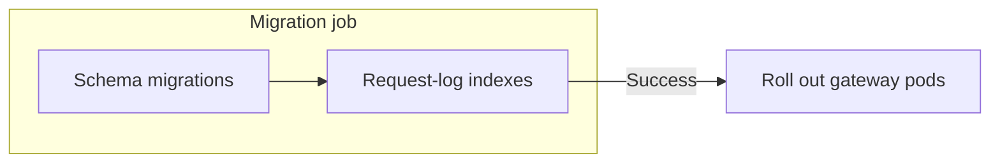

# Upgrade Guide

Helm charts and the official Terraform modules provide a **separate migration job** for schema changes and request-log indexing. Keep `DISABLE_SCHEMA_UPDATE=true` on the gateway pods and let the job finish before rolling out the new gateway version.



## Before you upgrade

Read the [release notes](/release_notes) for the versions you will cross. Check breaking changes and database changes, take a database snapshot, and test the upgrade against a restored copy of production to measure its duration. Rolling back an image does not undo database changes.

### Dry-run the migrations before the upgrade

From v1.109.0 the proxy applies the pending migrations at boot and lets PostgreSQL report the first one the database cannot take, the same way it reports any other failed migration (see [migration troubleshooting](../troubleshoot/prisma_migrations.md#6-database-migration-cannot-proceed-on-rows-the-schema-change-cannot-take)). To see that outcome before the upgrade window, run the dry run from any machine that can reach the database, with the **target** image:

```bash
docker run \
-e DATABASE_URL=postgresql://<user>:<password>@<host>:5432/<dbname> \
docker.litellm.ai/berriai/litellm:X.Y.Z --check_migrations_against_existing_data
```

It runs the real SQL of every pending migration, in order, each inside its own transaction that is rolled back before the next one starts, so `_prisma_migrations` and the schema are left exactly as they were and no lock outlives its migration, the same way the real upgrade commits one migration file at a time. A migration that depends on the one before it (an index on a column the previous migration adds) is replayed together with it. Exit code 0 lists each migration with the time it took, which is the time the real upgrade will hold that migration's locks:

```
LiteLLM Proxy: 2 pending migration(s) applied one at a time in a dry run, each rolled back before the next so its locks are released, nothing changed:
  20991231000000_require_team_alias: 0.0 s
  20991231000001_team_alias_index: 0.0 s
```

Exit code 2 prints PostgreSQL's own error for the first migration that fails. Nothing after it runs, and the migrations before it are listed with their times:

```
LiteLLM Proxy: Database migration cannot proceed. Migration 20991231000000_require_team_alias fails on this database after 0.0 s, nothing was applied.
column "team_alias" of relation "LiteLLM_TeamTable" contains null values
```

Because the statements really run, the dry run takes the same table locks the upgrade will, for as long as each statement takes, and a `CREATE INDEX` on a large `LiteLLM_SpendLogs` holds writes off that table for minutes. Run it off-peak or against a restored copy of production. An index a migration builds `CONCURRENTLY` is built the plain way inside the transaction, since PostgreSQL does not allow the concurrent form there. A database that has the tables but no `_prisma_migrations` history is not replayed: the dry run asks the same questions the boot asks before it baselines, that the migrations folder is the one this build ships (a custom `LITELLM_MIGRATION_DIR` is refused) and that the live schema matches this build's `schema.prisma`, and reports `nothing to dry-run` when both hold or the refusal (the `prisma migrate diff`, or the custom folder) when one does not. The request-log indexes the proxy builds in the background after it starts serving are not part of the dry run; on v1.108.0 only, the same flag ran read-only row counts instead and the proxy refused to boot on what they found.

## Upgrade with Helm or Terraform

| Deployment | Select the release | Run migrations before rollout |
|---|---|---|
| [Helm](./deploy.md#deploy-with-helm) | Pin the chart and image versions. Keep the migration job and application images on the same LiteLLM release. | Keep `migrationJob.enabled: true` and enable the hook for your deployment controller. Wait for the job to complete. |
| [Terraform](./deploy.md#deploy-with-terraform-aws-and-gcp) | Bump the module `version`. Component images default to that release; review any image overrides. | Run `terraform init -upgrade`, review `terraform plan`, then apply. The modules run an ECS migration task on AWS or a Cloud Run migration job on GCP before updating the services. |

<details>
<summary>Helm and Argo CD hook settings</summary>

For `helm upgrade`, use these values. The componentized `litellm` chart defaults to Helm hooks; the older `litellm-helm` chart defaults to Argo CD hooks and needs this change when used with Helm directly.

```yaml title="values.yaml"
migrationJob:
  enabled: true
  hooks:
    helm:
      enabled: true
    argocd:
      enabled: false
```

For Argo CD, enable `argocd` and disable `helm` instead. The PreSync job then runs before the application sync. See the chart values for [`litellm`](https://github.com/BerriAI/litellm/blob/main/helm/litellm/values.yaml) and [`litellm-helm`](https://github.com/BerriAI/litellm/blob/main/helm/litellm-helm/values.yaml).

</details>

Check the **migration job logs** for both schema and indexing completion. After the gateway rollout, verify [`/health/readiness`](./health.md#probe-endpoints) and send a test request through the gateway.

## Database migrations

### What takes time

The migration job runs schema migrations first, then builds any missing request-log indexes. **Both stages count toward the job's runtime.** Existing valid indexes are skipped.

| Work | What affects duration | Effect on the database |
|---|---|---|
| Schema changes, such as new tables or nullable columns | Usually short; lock waits can still delay them | Brief locks can delay other queries |
| Request-log indexes | `LiteLLM_SpendLogs` size, disk speed, memory, and database load | Concurrent index builds allow reads and writes, but consume database resources |
| A migration with a plain index build, table rewrite, or data backfill | Rows scanned or changed; inspect the release's migration SQL | Can block writes or other queries; test and plan a maintenance window if needed |

### Expected duration

Time the **complete migration job** against a production-sized database copy. A schema-only upgrade can be quick while a new index on a large spend-log table takes much longer. Table size alone is not enough to predict an upgrade window.

For Helm, set `migrationJob.activeDeadlineSeconds` (default **1800 seconds**) and the deployment controller's timeout to cover the complete job. With `helm upgrade`, also set `--timeout` accordingly. For Terraform, check the ECS task or Cloud Run job timeout and the deployment wait limit; Helm settings do not apply there.

Use [spend-log retention](./spend_logs_deletion.md) to limit the data future index builds must scan.

<details>
<summary>Check which schema migrations are already applied</summary>

```sql
SELECT migration_name, finished_at
FROM "_prisma_migrations"
WHERE finished_at IS NOT NULL
  AND rolled_back_at IS NULL
ORDER BY finished_at;
```

Compare the full result with the [migration files](https://github.com/BerriAI/litellm/tree/main/litellm-proxy-extras/litellm_proxy_extras/migrations) at your **target release tag**, rather than `main`. Inspect pending SQL for operations on large tables. Request-log indexing is a separate stage, so migration history alone does not confirm that the job is done.

</details>

### Indexes the job leaves for you to build

<SinceVersion v="1.109.0" />

The migration job builds the index behind the Logs page **Error Code** filter, `LiteLLM_SpendLogs_error_code_startTime_idx`, only while `LiteLLM_SpendLogs` takes at most **4 GiB** on disk, partitions included. On a larger table it skips that index so the upgrade does not wait on a long build, logs a warning that starts with `Not building index LiteLLM_SpendLogs_error_code_startTime_idx`, and still exits successfully. Until the index exists, filtering logs by error code reads every spend log row in the date window.

Build it off-peak. On a spend log table that is not partitioned, run this statement. It reads the whole table, and reads and writes keep working while it runs:

```sql
CREATE INDEX CONCURRENTLY IF NOT EXISTS "LiteLLM_SpendLogs_error_code_startTime_idx"
ON "public"."LiteLLM_SpendLogs" ((left(metadata->'error_information'->>'error_code', 128)), "startTime")
WHERE (metadata->'error_information'->>'error_code') IS NOT NULL;
```

On a partitioned table, or after an interrupted build, run the statements from the warning instead. The warning puts one statement on each line, and each one must run on its own, so save them to a file and run `psql -f <file>`; passing them together to `psql -c` fails with `CREATE INDEX CONCURRENTLY cannot run inside a transaction block`. The Helm charts delete the finished migration job, and its logs, after 120 seconds (`migrationJob.ttlSecondsAfterFinished`), so read the logs while the job runs or check for the index afterwards:

```sql
SELECT indisvalid FROM pg_index WHERE indexrelid = to_regclass('"LiteLLM_SpendLogs_error_code_startTime_idx"');
```

`t` means the index is built. No row means it is missing, and `f` means an interrupted build left it unusable, which the statements from the next warning repair. The next migration job finds a built index in place and logs `Request-log indexes are all in place`.

## Custom deployments

If your deployment does not provide a migration job, run this in a separate container using the **target LiteLLM proxy image**, with `DATABASE_URL` and the required database credentials configured:

```bash
DISABLE_SCHEMA_UPDATE=false litellm --skip_server_startup
```

This LiteLLM command runs schema migrations **and request-log indexing**, waits for both to finish, and exits without starting the gateway. Require a successful exit before rolling out gateway containers with `DISABLE_SCHEMA_UPDATE=true`. A migration the rows cannot take fails inside this command with PostgreSQL's error and the command exits non-zero, see [the dry run](#dry-run-the-migrations-before-the-upgrade) to catch that earlier.

## When a migration is slow or stuck

Start with the **migration job's logs and status**. Check database lock waits in `pg_stat_activity` and index-build progress in `pg_stat_progress_create_index` before changing timeouts.

`LITELLM_PRISMA_MIGRATE_DEPLOY_TIMEOUT` controls the schema migration subprocess (default **600 seconds**). Set it on the **migration job** if that stage needs longer; it does not cover request-log indexing. The whole-job and deployment timeouts must allow enough time for both stages and retries.

See [migration troubleshooting](../troubleshoot/prisma_migrations.md) for failed migrations and PostgreSQL version-specific issues.
