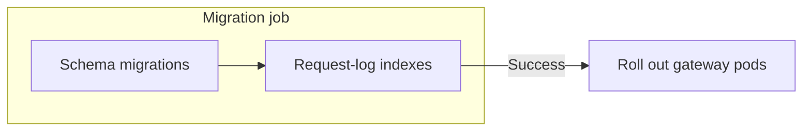

# Upgrade Guide

Helm charts and the official Terraform modules provide a **separate migration job** for schema changes and request-log indexing. Keep `DISABLE_SCHEMA_UPDATE=true` on the gateway pods and let the job finish before rolling out the new gateway version.



## Before you upgrade

Read the [release notes](/release_notes) for the versions you will cross. Check breaking changes and database changes, take a database snapshot, and test the upgrade against a restored copy of production to measure its duration. Rolling back an image does not undo database changes.

## Upgrade with Helm or Terraform

| Deployment | Select the release | Run migrations before rollout |
|---|---|---|
| [Helm](./deploy.md#deploy-with-helm) | Pin the chart and image versions. Keep the migration job and application images on the same LiteLLM release. | Keep `migrationJob.enabled: true` and enable the hook for your deployment controller. Wait for the job to complete. |
| [Terraform](./deploy.md#deploy-with-terraform-aws-and-gcp) | Bump the module `version`. Component images default to that release; review any image overrides. | Run `terraform init -upgrade`, review `terraform plan`, then apply. The modules run an ECS migration task on AWS or a Cloud Run migration job on GCP before updating the services. |

<details>
<summary>Helm and Argo CD hook settings</summary>

For `helm upgrade`, use these values. The componentized `litellm` chart defaults to Helm hooks; the older `litellm-helm` chart defaults to Argo CD hooks and needs this change when used with Helm directly.

```yaml title="values.yaml"
migrationJob:
  enabled: true
  hooks:
    helm:
      enabled: true
    argocd:
      enabled: false
```

For Argo CD, enable `argocd` and disable `helm` instead. The PreSync job then runs before the application sync. See the chart values for [`litellm`](https://github.com/BerriAI/litellm/blob/main/helm/litellm/values.yaml) and [`litellm-helm`](https://github.com/BerriAI/litellm/blob/main/helm/litellm-helm/values.yaml).

</details>

Check the **migration job logs** for both schema and indexing completion. After the gateway rollout, verify [`/health/readiness`](./health.md#probe-endpoints) and send a test request through the gateway.

## Database migrations

### What takes time

The migration job runs schema migrations first, then builds any missing request-log indexes. **Both stages count toward the job's runtime.** Existing valid indexes are skipped.

| Work | What affects duration | Effect on the database |
|---|---|---|
| Schema changes, such as new tables or nullable columns | Usually short; lock waits can still delay them | Brief locks can delay other queries |
| Request-log indexes | `LiteLLM_SpendLogs` size, disk speed, memory, and database load | Concurrent index builds allow reads and writes, but consume database resources |
| A migration with a plain index build, table rewrite, or data backfill | Rows scanned or changed; inspect the release's migration SQL | Can block writes or other queries; test and plan a maintenance window if needed |

### Expected duration

Time the **complete migration job** against a production-sized database copy. A schema-only upgrade can be quick while a new index on a large spend-log table takes much longer. Table size alone is not enough to predict an upgrade window.

For Helm, set `migrationJob.activeDeadlineSeconds` (default **1800 seconds**) and the deployment controller's timeout to cover the complete job. With `helm upgrade`, also set `--timeout` accordingly. For Terraform, check the ECS task or Cloud Run job timeout and the deployment wait limit; Helm settings do not apply there.

Use [spend-log retention](./spend_logs_deletion.md) to limit the data future index builds must scan.

<details>
<summary>Check which schema migrations are already applied</summary>

```sql
SELECT migration_name, finished_at
FROM "_prisma_migrations"
WHERE finished_at IS NOT NULL
  AND rolled_back_at IS NULL
ORDER BY finished_at;
```

Compare the full result with the [migration files](https://github.com/BerriAI/litellm/tree/main/litellm-proxy-extras/litellm_proxy_extras/migrations) at your **target release tag**, rather than `main`. Inspect pending SQL for operations on large tables. Request-log indexing is a separate stage, so migration history alone does not confirm that the job is done.

</details>

## Custom deployments

If your deployment does not provide a migration job, run this in a separate container using the **target LiteLLM proxy image**, with `DATABASE_URL` and the required database credentials configured:

```bash
DISABLE_SCHEMA_UPDATE=false litellm --skip_server_startup
```

This LiteLLM command runs schema migrations **and request-log indexing**, waits for both to finish, and exits without starting the gateway. Require a successful exit before rolling out gateway containers with `DISABLE_SCHEMA_UPDATE=true`.

## When a migration is slow or stuck

Start with the **migration job's logs and status**. Check database lock waits in `pg_stat_activity` and index-build progress in `pg_stat_progress_create_index` before changing timeouts.

`LITELLM_PRISMA_MIGRATE_DEPLOY_TIMEOUT` controls the schema migration subprocess (default **600 seconds**). Set it on the **migration job** if that stage needs longer; it does not cover request-log indexing. The whole-job and deployment timeouts must allow enough time for both stages and retries.

See [migration troubleshooting](../troubleshoot/prisma_migrations.md) for failed migrations and PostgreSQL version-specific issues.
