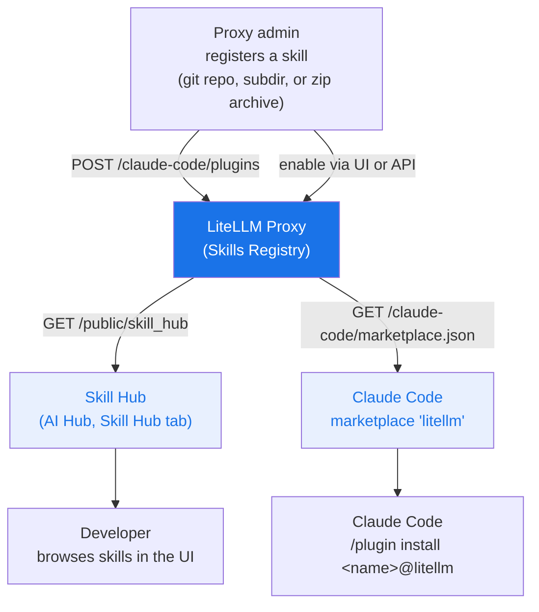

# Skills Gateway

<iframe width="840" height="500" src="https://www.loom.com/embed/cb74eb79df3e4c2b83a6efae54a589f9" frameBorder="0" allowFullScreen></iframe>

Use LiteLLM Skills Hub to upload, import, discover, and download [Agent Skills](https://agentskills.io/specification) packages for Codex, Claude Code, and other compatible agents. The neutral `/skill-hub/skills` API shares the existing registry and access grants with the Claude Code marketplace.

:::note Legacy management API

The `/claude-code/plugins` management endpoints are deprecated for new integrations. Use `/skill-hub` for portable skill management. Existing legacy endpoints remain available for compatibility; Claude Code marketplace discovery and installation remain supported.

:::

## Portable Agent Skills API

Apply the Skills Hub database migrations before using these APIs. With a key attached to a writable user, you can submit skills and updates for [admin review](#submissions-and-approval). Proxy admins publish without review; read-only users cannot submit.

Upload a ZIP containing `SKILL.md` at its root or inside one top-level folder. Supporting files such as `scripts/`, `references/`, `assets/`, and `agents/openai.yaml` retain their bytes and executable script permissions in portable downloads.

Declare a name and description in `SKILL.md`'s YAML frontmatter. Use 1–64 ASCII lowercase letters, digits, and single hyphens between name segments (`^[a-z0-9]+(?:-[a-z0-9]+)*$`). Descriptions must contain 1–1024 characters.

### Upload or import

A portable package can contain:

```text
pdf-summarizer/
  SKILL.md
  scripts/extract.sh
  agents/openai.yaml
```

For example, `SKILL.md` can contain:

```markdown
---
name: pdf-summarizer
description: Summarize PDFs with page citations.
---
Read the PDF and cite page numbers in the summary.
```

```bash
zip -r pdf-summarizer.zip pdf-summarizer
curl --fail-with-body https://your-proxy/skill-hub/skills/upload \
  -H "Authorization: Bearer $LITELLM_API_KEY" \
  -F "file=@pdf-summarizer.zip" \
  -F "version=1.0.0"
```

Import a public skill from skills.sh:

```bash
curl --fail-with-body https://your-proxy/skill-hub/skills/import \
  -H "Authorization: Bearer $LITELLM_API_KEY" \
  -H "Content-Type: application/json" \
  -d '{"url":"https://skills.sh/vercel-labs/agent-skills/vercel-react-best-practices"}'
```

Import from public HTTPS `skills.sh/<owner>/<repository>/<skill>` or `github.com/<owner>/<repository>` URLs. For a repository with multiple skills, select one with `skill` or the repository-relative `path`. Use `ref` for a commit, tag, or branch; it defaults to `HEAD`. A GitHub tree URL can supply the ref and directory. LiteLLM snapshots the selected directory and rejects symlinks within it. This endpoint rejects private repositories, SSH URLs, other hosts, and arbitrary archive URLs.

Keep upload and repository ZIPs within 10 MiB, 1,000 entries, and 50 MiB of unpacked data, including files outside the selected skill. Each selected file can use 10 MiB; `SKILL.md` can use 1 MiB. Leave room for generated compatibility metadata: the selected skill can contain at most 999 files, and the stored package must fit the unpacked-size limit. Oversized stored packages return `422`. Upload and import return `409` for an existing name; use an update route to replace it.

Uploads, imports, and ZIP replacements share a limit of **10 attempts per minute per user**, across that user's keys. Admin keys without a user use a per-key allowance; no-auth development mode shares one allowance. Exhausted requests return `429` with `Retry-After: 60`.

Use the default v3 rate limiter and shared Redis coordination to enforce the limit across workers or replicas. These routes return `503` if the default limiter is unavailable or you enable the legacy limiter.

Member requests return `status: "pending_review"`, `action: "submitted"`, `submission_id`, and `proposal`. Admin requests return the published skill. Members' submissions leave the catalog unchanged until an admin approves them. New publications are public; admins can use `POST /skill-hub/skills/{name}/unpublish` to make them private while retaining grants. Public CLI discovery requires the opt-in setting below.

### Browse and download

Use a LiteLLM key to list public skills and private skills granted to that key or its team:

```bash
curl --fail-with-body 'https://your-proxy/skill-hub/skills?query=pdf&offset=0&limit=20' \
  -H "Authorization: Bearer $LITELLM_API_KEY"

curl --fail-with-body https://your-proxy/skill-hub/skills/pdf-summarizer/content \
  -H "Authorization: Bearer $LITELLM_API_KEY"

curl --fail-with-body https://your-proxy/skill-hub/skills/pdf-summarizer/archive \
  -H "Authorization: Bearer $LITELLM_API_KEY" \
  -o pdf-summarizer.zip
```

The list response contains `skills`, `count`, and `next_offset`. Each managed package provides `download_url` and `content_url`. Entries that point to external sources can appear in the shared catalog without those URLs. The content route returns the original `SKILL.md`; the archive route includes its supporting files with `SKILL.md` at the ZIP root. These routes also serve existing managed Claude uploads that contain a valid Agent Skill. External Git or URL registrations keep their original sources.

| Endpoint | Auth | Purpose |
|----------|------|---------|
| `POST /skill-hub/skills/upload` | Writable user | Submit a portable ZIP; admins publish without review |
| `POST /skill-hub/skills/import` | Writable user | Submit a public GitHub or skills.sh snapshot; admins publish without review |
| `GET /skill-hub/skills` | LiteLLM key | Search visible skills with `query`, `offset`, and `limit` (1–100) |
| `GET /skill-hub/skills/{name}` | LiteLLM key | Read visible skill metadata and download URLs |
| `GET /skill-hub/skills/{name}/content` | LiteLLM key, or eligible public access | Read the original `SKILL.md` |
| `GET /skill-hub/skills/{name}/archive` | LiteLLM key, or eligible public access | Download the portable ZIP |
| `PUT /skill-hub/skills/{name}` | Writable user with access | Replace metadata; members submit for review |
| `PUT /skill-hub/skills/{name}/upload` | Writable user with access | Replace the ZIP; members submit for review |
| `POST /skill-hub/skills/{name}/publish` | Proxy admin | Make the registry entry public |
| `POST /skill-hub/skills/{name}/unpublish` | Proxy admin | Hide it from public discovery while retaining grants |
| `DELETE /skill-hub/skills/{name}` | Proxy admin | Delete the skill and managed archive |

Metadata `PUT` accepts `description`, `version`, `domain`, `namespace`, `keywords`, and `expected_updated_at`. Omitted descriptive fields clear; omitted or null `version` requests a patch bump. The archive, source, and Claude adapter settings stay unchanged.

Anonymous content and archive requests require a public skill, `litellm_settings.public_skills_index: true`, and marketplace authentication disabled. Authenticated downloads remain available when the public index is off. Private skills use the existing [key and team grants](#private-skills).

### Versions and updates

New skills default to `1.0.0`. Publishing an update records history and increments the patch version unless you supply a higher SemVer. Supply an explicit version for legacy skills with a missing or invalid version. Publishing or unpublishing changes visibility without creating a version.

To replace files, keep the same name in `SKILL.md`. Read the current timestamp with `jq` and pass it as `expected_updated_at` to protect against stale edits:

```bash
UPDATED_AT=$(curl --fail-with-body https://your-proxy/skill-hub/skills/pdf-summarizer \
  -H "Authorization: Bearer $LITELLM_API_KEY" | jq -r '.updated_at')

curl --fail-with-body -X PUT https://your-proxy/skill-hub/skills/pdf-summarizer/upload \
  -H "Authorization: Bearer $LITELLM_API_KEY" \
  -F "file=@pdf-summarizer.zip" \
  -F "version=1.1.0" \
  -F "expected_updated_at=$UPDATED_AT"

curl --fail-with-body 'https://your-proxy/skill-hub/skills/pdf-summarizer/versions?limit=20&offset=0' \
  -H "Authorization: Bearer $LITELLM_API_KEY"
```

History returns `versions` and `next_offset`. Each entry contains `id`, `version`, `published_at`, `published_by`, `content_kind`, and `download_url`. Use the entry's **`id`** as `version_id` in `GET /skill-hub/skills/{name}/versions/{version_id}` and `GET /skill-hub/skills/{name}/versions/{version_id}/archive`. A SemVer string cannot identify an entry. A `stored_archive` entry includes a portable ZIP; a `source_reference` retains metadata without external files. Use a key with current access to the skill. Deleting the skill deletes its history.

### Submissions and approval

Open **Skills → Submissions** to see your proposals. Proxy admins and admin viewers can inspect proposals from all users; approval and rejection require a proxy admin. To revise an immutable proposal, submit a new one. The published skill stays unchanged until approval.

Set `SUBMISSION_ID` to the `submission_id` returned by a member upload, import, or update. With a proxy admin key in `LITELLM_MASTER_KEY`, inspect and approve it:

```bash
curl --fail-with-body 'https://your-proxy/skill-hub/submissions?status=pending_review&limit=20&offset=0' \
  -H "Authorization: Bearer $LITELLM_MASTER_KEY"

curl --fail-with-body "https://your-proxy/skill-hub/submissions/$SUBMISSION_ID" \
  -H "Authorization: Bearer $LITELLM_MASTER_KEY"

curl --fail-with-body -X PUT "https://your-proxy/skill-hub/submissions/$SUBMISSION_ID/approve" \
  -H "Authorization: Bearer $LITELLM_MASTER_KEY"
```

The list returns `submissions`, the page's `count`, and `has_more`; use `offset` for pagination. Compare `submission` and `current_skill` in the detail response. Submitters and admins can download proposals with `has_archive: true` at `GET /skill-hub/submissions/{submission_id}/archive`. To reject, send `PUT /skill-hub/submissions/{submission_id}/reject` with an optional JSON body such as `{"reason":"Remove the embedded credentials"}`. Review responses contain `action`, `submission`, and `skill` (`null` on rejection).

A stale update or conflicting approval returns `409`; reload the published skill and submit a revised proposal. Each member can have at most 20 pending proposals and 50 MiB of pending metadata and archives; exceeding either cap returns `429`. Existing `/claude-code/plugins` write routes remain admin-only.

### Optional security scans

Deploy the [SkillSpector adapter](https://github.com/BerriAI/litellm/tree/main/cookbook/skill_scanner) on a separate service and configure its shared secret in the gateway environment:

```yaml title="config.yaml"
general_settings:
  skill_scanner:
    endpoint: https://scanner.example.com/scan
    api_key_env: SKILL_SCANNER_API_KEY
    use_llm: false
    timeout_seconds: 180
```

Use an HTTPS endpoint reachable from the gateway, or HTTP loopback for local development. For semantic analysis, set `use_llm: true` and configure provider credentials on the scanner host.

Before reviewing a pending proposal, a proxy admin can select **Scan for threats** in its review dialog, or call:

```bash
curl --fail-with-body -X POST "https://your-proxy/skill-hub/submissions/$SUBMISSION_ID/scan" \
  -H "Authorization: Bearer $LITELLM_MASTER_KEY"

curl --fail-with-body "https://your-proxy/skill-hub/submissions/$SUBMISSION_ID/scan" \
  -H "Authorization: Bearer $LITELLM_MASTER_KEY"
```

Both responses contain `configured` and `scan`. Repeat GET until `scan.status` is `completed` or `failed`. For completed scans, review the findings, risk score, scan mode, limitations, and `report.complete`. For failures, read `scan.error`. Reports require admin access. Retry failed or interrupted scans with POST; each attempt replaces the previous result. Missing scanner configuration returns `503` on POST; GET retains saved reports.

Admins decide whether to approve or reject, with or without a scan. The scanner examines stored ZIP bytes; remote-source reports describe the source at scan time. Review the findings before trusting a skill.

### Download counts and history

Proxy admins see a **Downloads** column in Skills and a download-history tab in each skill. `GET /skill-hub/skills` includes `download_count` for admins. To fetch totals and authenticated downloader history:

```bash
curl --fail-with-body 'https://your-proxy/skill-hub/skills/pdf-summarizer/downloads?limit=25' \
  -H "Authorization: Bearer $LITELLM_MASTER_KEY"
```

The response contains `total_downloads`, `anonymous_downloads`, `downloads`, and `next_cursor`. Pass a non-null `next_cursor` as `cursor` to fetch the next page. Events include `downloaded_at`, `version`, `digest`, and available user, key-alias, and team identifiers. This endpoint is admin-only.

Counts start when you deploy tracking and include repeat portable, Claude-compatible, and retained-version ZIP requests through the gateway. Anonymous requests add to totals without individual events. With a shared key, you can identify the key's owner but cannot distinguish its users. LiteLLM does not track external downloads, completed installations, or execution.

## Claude Code marketplace {#how-it-works}



Enabled skills are public; disabled skills are private and only reach keys or teams that were granted them (see [Private skills](#private-skills)). New skills are enabled when published. The `/claude-code/plugins` write routes below require a proxy admin; members use the portable API's submission flow above.

## Quick start

### 1. Register a skill

In the Admin UI, open **Skills** to upload a ZIP or import from GitHub or skills.sh through the portable API above. To register an external source for Claude Code to fetch directly, use the following API with an admin key:

```bash
curl -X POST https://your-proxy/claude-code/plugins \
  -H "Authorization: Bearer $LITELLM_MASTER_KEY" \
  -H "Content-Type: application/json" \
  -d '{
    "name": "grill-me",
    "source": {
      "source": "git-subdir",
      "url": "https://github.com/mattpocock/skills",
      "path": "skills/productivity/grill-me"
    },
    "description": "Interview skill for relentless questioning",
    "domain": "Productivity",
    "namespace": "interviews"
  }'
```

`POST` only creates. Registering a name that already exists returns `409`; change an existing skill with `PUT /claude-code/plugins/{name}` instead.

### 2. Publish or unpublish

A newly registered skill is already enabled and public. To change which skills are public, use the Admin UI: **AI Hub → Skill Hub → Select Skills to Make Public**.

Or the API, with `/disable` to unpublish and `/enable` to publish again:

```bash
curl -X POST https://your-proxy/claude-code/plugins/grill-me/disable \
  -H "Authorization: Bearer $LITELLM_MASTER_KEY"
```

### 3. Browse the hub

Public skills appear in the Admin UI under **AI Hub → Skill Hub**, on the public page at `/ui/model_hub` under the **Skill Hub** tab (no login required), and through the API at `GET /public/skill_hub`.

### 4. Install in Claude Code

Add the proxy marketplace once. The marketplace is always named `litellm`:

```
/plugin marketplace add https://your-proxy/claude-code/marketplace.json
```

Then install any skill by `<name>@litellm`:

```
/plugin install grill-me@litellm
```

The same commands work from a shell as `claude plugin marketplace add <url>` and `claude plugin install grill-me@litellm`.

To roll the marketplace out through settings instead, add it to `extraKnownMarketplaces`. The `source` value is an object; a flat `"source": "url"` entry is rejected by Claude Code as an invalid marketplace entry and ignored:

```json title="~/.claude/settings.json"
{
  "extraKnownMarketplaces": {
    "litellm": {
      "source": {
        "source": "url",
        "url": "https://your-proxy/claude-code/marketplace.json"
      }
    }
  }
}
```

## Private skills

A disabled skill stays out of the Skill Hub and the anonymous `marketplace.json`, but you can grant it to specific keys or teams through `object_permission.skills`. In the Admin UI use **Allowed Skills** when creating or editing a key or team. Through the API:

```bash
curl -X POST https://your-proxy/key/generate \
  -H "Authorization: Bearer $LITELLM_MASTER_KEY" \
  -H "Content-Type: application/json" \
  -d '{"object_permission": {"skills": ["internal-runbook"]}}'
```

When both the key and its team list skills, the key gets the intersection of the two lists; otherwise it gets whichever list is set. Developers add the key to the marketplace URL so their granted skills show up next to the public ones:

```
/plugin marketplace add "https://your-proxy/claude-code/marketplace.json?key=sk-..."
```

`GET /claude-code/plugins` and `GET /claude-code/plugins/{name}` apply the same rule: a non-admin key sees enabled skills plus the ones granted to it, and gets a `403` for a disabled skill it was not granted. Proxy admins see everything.

## Skill fields

| Field | Description |
|-------|-------------|
| `name` | Unique kebab-case identifier (`^[a-z0-9-]+$`), used in `/plugin install <name>@litellm`. Set on create and fixed afterwards |
| `source` | Where Claude Code fetches the skill from; see [Source formats](#source-formats) |
| `description` | Short description shown in the hub |
| `domain` | Top-level grouping in the Skill Hub (e.g. `Engineering`, `Productivity`) |
| `namespace` | Sub-grouping within a domain (e.g. `quality`, `meetings`) |
| `category` | Category shown in the marketplace |
| `keywords` | Tags for search and filtering |
| `version` | Semver string; defaults to `1.0.0` on create |
| `installation_preference` | <SinceVersion v="1.107.0" /> Optional `available`, `auto_install`, or `required`, served as `installationPreference` for [Claude Desktop auto-install](./tutorials/claude_code_plugin_marketplace.md#auto-install-plugins-in-claude-desktop). Needs an `archive` source, and `auto_install` and `required` also need its `sha256`. Claude Desktop treats a per-plugin `required` like `auto_install`, so users can still remove it |
| `author` | `{"name": "...", "email": "..."}` |
| `homepage` | Homepage URL |

## Source formats

| `source.source` | Required fields | Example |
|-----------------|-----------------|---------|
| `github` | `repo` | `{"source": "github", "repo": "org/repo"}` |
| `url` | `url` | `{"source": "url", "url": "https://gitlab.com/org/repo.git"}` |
| `git-subdir` | `url`, `path` | `{"source": "git-subdir", "url": "https://github.com/org/repo.git", "path": "skills/my-skill"}` |
| `archive` | `url` (HTTPS), optional `sha256` | `{"source": "archive", "url": "https://bucket.s3.amazonaws.com/my-skill.zip", "sha256": "<64 hex chars>"}` |

`git-subdir` paths must be relative slash-separated segments of letters, digits, dots, hyphens, and underscores. `archive` URLs must use HTTPS, and `sha256`, when present, must be a 64-character hex digest. Claude Code downloads from these sources on the developer's machine, so private repositories and archives need credentials there.

## Legacy API reference {#api-reference}

| Endpoint | Auth | Description |
|----------|------|-------------|
| `POST /claude-code/plugins` | Proxy admin | Create a skill (`409` if the name exists) |
| `GET /claude-code/plugins` | Any key | List the skills visible to the caller. `?enabled_only=true` returns only public skills |
| `GET /claude-code/plugins/{name}` | Any key | Get one skill (`403` if it is disabled and not granted to the caller) |
| `PUT /claude-code/plugins/{name}` | Proxy admin | Replace a skill. Omitted descriptive fields reset to defaults and `installation_preference` clears; omitted `version` requests a patch bump |
| `POST /claude-code/plugins/{name}/enable` | Proxy admin | Publish a skill |
| `POST /claude-code/plugins/{name}/disable` | Proxy admin | Unpublish a skill |
| `DELETE /claude-code/plugins/{name}` | Proxy admin | Delete a skill |
| `GET /public/skill_hub` | None | List public skills |
| `GET /claude-code/marketplace.json` | None, or `?key=` | Claude Code marketplace manifest. `?key=` adds the disabled skills granted to that key |

## Agent Skills discovery index

The Hub contributes public packages created through `/skill-hub/skills/upload` or `/skill-hub/skills/import`. Existing managed Claude uploads can use neutral downloads when valid, but do not automatically appear in this index.

The index also retains skills uploaded to the proxy's own store through [`/v1/skills`](./skills.md) with `custom_llm_provider=litellm_proxy`. That provider-compatible API and its storage remain separate from the Hub API. The combined index contains at most 1,000 skills, with hosted-store entries retaining priority. Name collisions receive unique installation aliases, while the original `SKILL.md` remains unchanged.

The index is off by default. Enabling it exposes installable skills from the hosted `/v1/skills` store to anyone who can reach the proxy, alongside eligible public Hub packages:

```yaml title="config.yaml"
litellm_settings:
  public_skills_index: true
```

The index is available at `GET /.well-known/agent-skills/index.json`, with `/.well-known/skills/index.json` as an alias. Hosted-store archives retain `GET /v1/skills/{skill_id}/archive`; Hub entries use `GET /skill-hub/skills/{name}/archive`. The two index routes and the hosted-store archive route return `404` while `public_skills_index` is off.

Hub packages appear in the anonymous index only when they are public and `general_settings.claude_code_marketplace_auth_required` is not enabled. That authentication setting does not change the existing hosted-store publication behavior.

### Install in Codex and Claude Code

From your project directory, use Node.js 22.20.0 or newer and the pinned [skills CLI 1.7.6](https://www.npmjs.com/package/skills/v/1.7.6):

```bash
npx --yes skills@1.7.6 add https://your-proxy \
  --skill pdf-summarizer --agent codex claude-code --copy --yes
```

Replace `pdf-summarizer` with a skill name in your public index. The CLI installs the package for both selected agents. Use `--list` instead of the selection and installation flags to inspect the available skills.

The [pinned CLI's well-known provider](https://github.com/vercel-labs/skills/blob/7a5e920bead4b1039a6d6df5d7e1163b7b09423a/src/providers/wellknown.ts) sends no LiteLLM authentication headers when it fetches the index or archive URLs. This installation flow therefore requires anonymous access to the selected package. For private skills, download the archive with an authorized key through the neutral API above. The Claude marketplace's `?key=` flow remains separate.
