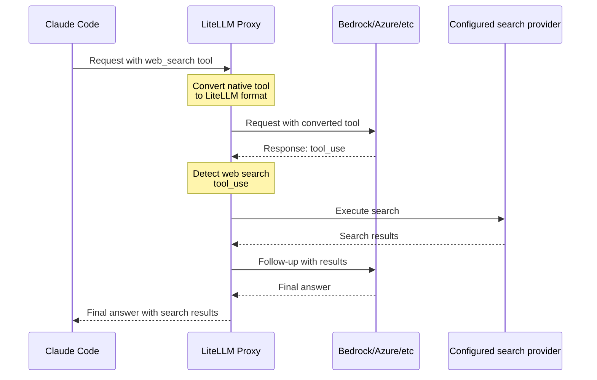

import Image from '@theme/IdealImage';

# Claude Code - WebSearch Across All Providers

Enable Claude Code's web search tool to work with any provider (Bedrock, Azure, Vertex, etc.). LiteLLM automatically intercepts web search requests and executes them server-side.

<Image img={require('../../img/claude_code_websearch.png')} />

## Proxy Configuration

Add WebSearch interception to your `litellm_config.yaml`:

```yaml showLineNumbers title="litellm_config.yaml"
model_list:
  - model_name: bedrock-sonnet
    litellm_params:
      model: bedrock/us.anthropic.{{anthropic}}
      aws_region_name: us-east-1

# Enable WebSearch interception for providers
litellm_settings:
  callbacks: ["websearch_interception"]
  websearch_interception_params:
    enabled_providers:
      - bedrock
      - azure
      - vertex_ai
    search_tool_name: perplexity-search  # Optional: specific search tool

# Configure search provider
search_tools:
  - search_tool_name: perplexity-search
    litellm_params:
      search_provider: perplexity
      api_key: os.environ/PERPLEXITY_API_KEY
```

## Quick Start

### 1. Configure LiteLLM Proxy

Create `config.yaml`:

```yaml showLineNumbers title="config.yaml"
model_list:
  - model_name: bedrock-sonnet
    litellm_params:
      model: bedrock/us.anthropic.{{anthropic}}
      aws_region_name: us-east-1

litellm_settings:
  callbacks: ["websearch_interception"]
  websearch_interception_params:
    enabled_providers: [bedrock]

search_tools:
  - search_tool_name: perplexity-search
    litellm_params:
      search_provider: perplexity
      api_key: os.environ/PERPLEXITY_API_KEY
```

To use Parallel Search instead, set `PARALLEL_API_KEY` and replace the `litellm_settings` and `search_tools` sections:

```yaml showLineNumbers title="Parallel Search configuration"
litellm_settings:
  callbacks: ["websearch_interception"]
  websearch_interception_params:
    enabled_providers: [bedrock]
    search_tool_name: parallel-search

search_tools:
  - search_tool_name: parallel-search
    litellm_params:
      search_provider: parallel_ai
      api_key: os.environ/PARALLEL_API_KEY
```

### 2. Start Proxy

```bash showLineNumbers title="Start LiteLLM Proxy"
# For Parallel Search, export PARALLEL_API_KEY=your-key instead.
export PERPLEXITY_API_KEY=your-key
litellm --config config.yaml
```

### 3. Use with Claude Code

```bash showLineNumbers title="Configure Claude Code"
export ANTHROPIC_BASE_URL=http://localhost:4000
export ANTHROPIC_API_KEY=sk-<your-api-key>
claude
```

Now use web search in Claude Code - it works with any provider!

## How It Works

When Claude Code sends a web search request, LiteLLM:
1. Intercepts the native `web_search` tool
2. Converts it to LiteLLM's standard format
3. Executes the search using the configured provider, such as Parallel, Perplexity, or Tavily
4. Returns the final answer to Claude Code



**Result**: One API call from Claude Code → Complete answer with search results

## Supported Providers

| Provider | Native Web Search | With LiteLLM |
|----------|-------------------|--------------|
| **Anthropic** | ✅ Yes | ✅ Yes |
| **Bedrock** | ❌ No | ✅ Yes |
| **Azure** | ❌ No | ✅ Yes |
| **Vertex AI** | ❌ No | ✅ Yes |
| **Other Providers** | ❌ No | ✅ Yes |

## Search Providers

Any search provider LiteLLM supports can run Claude Code's web searches. Set its `search_provider` value in `search_tools`:

| Provider | `search_provider` Value | Environment Variable |
|----------|------------------------|----------------------|
| [**Perplexity AI**](../search/perplexity.md) | `perplexity` | `PERPLEXITYAI_API_KEY` |
| [**Tavily**](../search/tavily.md) | `tavily` | `TAVILY_API_KEY` |
| [**Exa AI**](../search/exa_ai.md) | `exa_ai` | `EXA_API_KEY` |
| [**Parallel AI**](../search/parallel_ai.md) | `parallel_ai` | `PARALLEL_AI_API_KEY` |
| [**Google PSE**](../search/google_pse.md) | `google_pse` | `GOOGLE_PSE_API_KEY`, `GOOGLE_PSE_ENGINE_ID` |
| [**DataForSEO**](../search/dataforseo.md) | `dataforseo` | `DATAFORSEO_LOGIN`, `DATAFORSEO_PASSWORD` |
| [**Firecrawl**](../search/firecrawl.md) | `firecrawl` | `FIRECRAWL_API_KEY` |
| [**SearXNG**](../search/searxng.md) | `searxng` | `SEARXNG_API_BASE` (required) |
| [**Linkup**](../search/linkup.md) | `linkup` | `LINKUP_API_KEY` |
| [**Brave Search**](../search/brave.md) | `brave` | `BRAVE_API_KEY` |
| [**fastCRW**](https://fastcrw.com/docs/rest-api) | `fastcrw` | `CRW_API_KEY` |
| [**DuckDuckGo**](https://duckduckgo.com/api) | `duckduckgo` | None |
| [**SearchAPI.io**](../search/searchapi.md) | `searchapi` | `SEARCHAPI_API_KEY` |
| [**Serper**](../search/serper.md) | `serper` | `SERPER_API_KEY` |
| [**You.com**](../search/you_com.md) | `you_com` | `YOUCOM_API_KEY` (optional) |
| [**APISerpent**](../search/apiserpent.md) | `apiserpent` | `APISERPENT_API_KEY` |
| [**TinyFish**](https://docs.tinyfish.ai/search-api) | `tinyfish` | `TINYFISH_API_KEY` |
| [**Bedrock AgentCore**](../search/agentcore.md) | `agentcore` | `AGENTCORE_GATEWAY_URL`, AWS credentials or `AGENTCORE_GATEWAY_TOKEN` |
| [**Nimble**](../search/nimble.md) | `nimble` | `NIMBLE_API_KEY` |
| [**Grounding with Bing**](../search/bing_grounding.md) | `bing_grounding` | `BING_GROUNDING_PROJECT_ENDPOINT`, `BING_GROUNDING_MODEL`, Azure credentials or `BING_GROUNDING_TOKEN` |
| [**DeepSeek**](../search/deepseek.md) | `deepseek` | `DEEPSEEK_API_KEY` |
| [**xAI X Search**](https://docs.x.ai/developers/tools/x-search) (from v1.109.0) | `xai` | `XAI_API_KEY` |

See [all supported search providers](../search/index.md) for detailed setup instructions and provider-specific parameters.

## Configuration Options

### WebSearch Interception Parameters

| Parameter | Type | Required | Description | Example |
|-----------|------|----------|-------------|---------|
| `enabled_providers` | List[String] | Yes | List of providers to enable web search interception for | `[bedrock, azure, vertex_ai]` |
| `search_tool_name` | String | No | Specific search tool from `search_tools` config. If not set, uses first available search tool. | `perplexity-search` |

### Supported Provider Values

Use these values in `enabled_providers`:

| Provider | Value | Description |
|----------|-------|-------------|
| AWS Bedrock | `bedrock` | Amazon Bedrock Claude models |
| Azure OpenAI | `azure` | Azure-hosted models |
| Google Vertex AI | `vertex_ai` | Google Cloud Vertex AI |
| Any Other | Provider name | Any LiteLLM-supported provider |

### Complete Configuration Example

```yaml showLineNumbers title="Complete config.yaml"
model_list:
  - model_name: bedrock-sonnet
    litellm_params:
      model: bedrock/us.anthropic.{{anthropic}}
      aws_region_name: us-east-1

  - model_name: azure-gpt
    litellm_params:
      model: azure/{{openai_large}}
      api_base: https://my-azure.openai.azure.com
      api_key: os.environ/AZURE_API_KEY

litellm_settings:
  callbacks: ["websearch_interception"]
  websearch_interception_params:
    enabled_providers:
      - bedrock        # Enable for AWS Bedrock
      - azure          # Enable for Azure OpenAI
      - vertex_ai      # Enable for Google Vertex
    search_tool_name: perplexity-search  # Optional: use specific search tool

# Configure search tools
search_tools:
  - search_tool_name: perplexity-search
    litellm_params:
      search_provider: perplexity
      api_key: os.environ/PERPLEXITY_API_KEY

  - search_tool_name: tavily-search
    litellm_params:
      search_provider: tavily
      api_key: os.environ/TAVILY_API_KEY
```

**How search tool selection works:**
- If `search_tool_name` is specified → Uses that specific search tool
- If `search_tool_name` is not specified → Uses first search tool in `search_tools` list
- In example above: Without `search_tool_name`, would use `perplexity-search` (first in list)

## Related

- [Claude Code Quickstart](./claude_responses_api.md)
- [Claude Code Cost Tracking](./claude_code_customer_tracking.md)
- [Using Non-Anthropic Models](./claude_non_anthropic_models.md)
